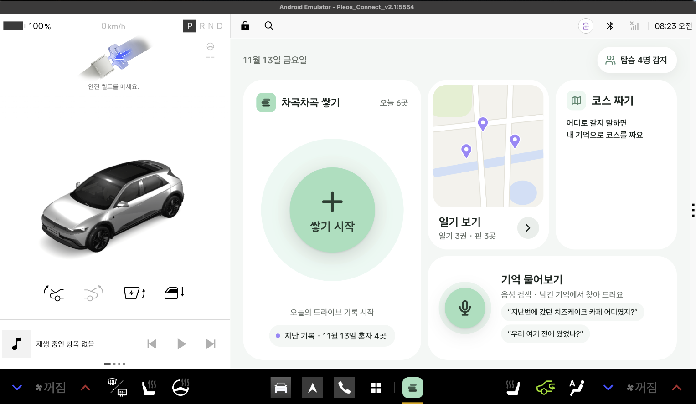
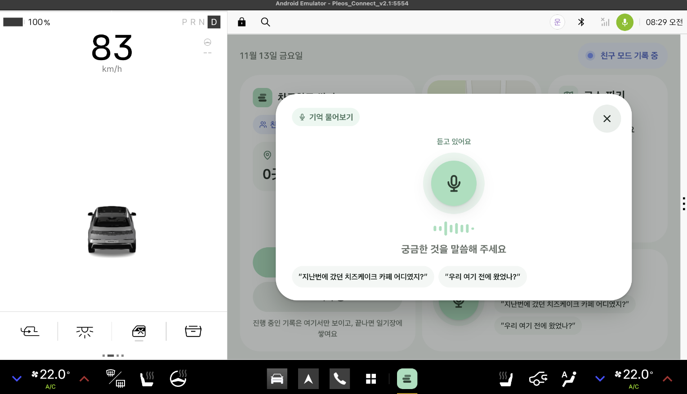
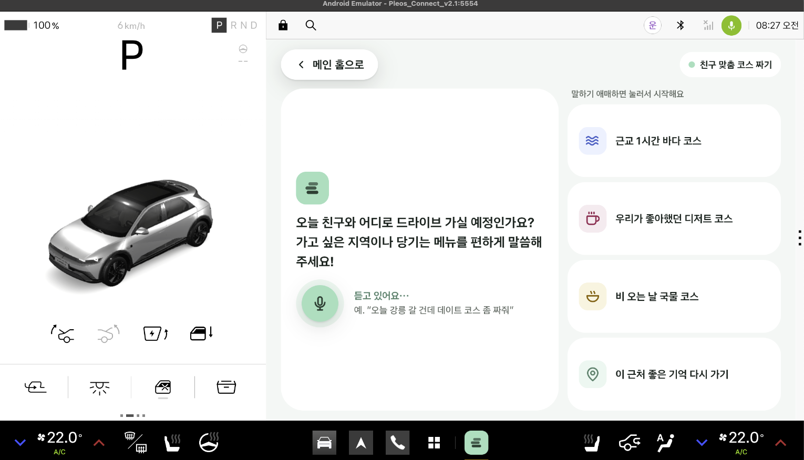

# 차곡차곡

## 1. 앱 이름 및 한 줄 소개

- **앱 이름**: 차곡차곡
- **한 줄 소개**: 함께한 사람들과의 추억을 차에 차곡차곡 쌓고, "우리 여기 왔었나?"라는 한마디에 그날의 기억을 꺼내 다시 데려다주는 드라이브 일기 앱

| 홈 | 기억 물어보기 | 코스 짜기 |
|---|---|---|
|  |  |  |

## 프로젝트 구조

| 모듈 | 역할 |
|---|---|
| `app` | 앱 진입점, 화면 연결, 화면 밀도 보정 |
| `feature` | 화면과 화면 상태 (쌓기, 주행 패널, 기억 남기기, 일기 완성, 일기 보기, 기억 물어보기, 코스 짜기) |
| `core:domain` | 기록 엔진·일기·차량·음성 인터페이스와 기억 찾기·코스 재료 고르기 규칙 |
| `core:database` | Room 저장소 (기록, 장소, 방문) |
| `core:pleos` | Pleos SDK·AAOS 차량 API 연동 (좌석, 내비, 음성 인식·출력, 주행 제한, 시동 신호) |
| `core:designsystem` | 색·글꼴·부품 (글꼴: Asta Sans, `core/designsystem/licenses/AstaSans-OFL.txt`) |
| `core:remote` | 외부 서비스 연동 (LLM, kakao local api) |

## 2. 실행 방법

### APK 설치

에뮬레이터를 켠 뒤 저장소 최상위 폴더에서 설치합니다.

```bash
adb install -r apk/chueogtang_chagokchagok_release.apk
```

같은 패키지의 다른 서명 빌드(예: 개발용 debug 빌드)가 이미 설치돼 있으면 서명이 달라 설치되지 않습니다. 이때는 먼저 지운 뒤 설치합니다(기존 기록도 함께 지워집니다).

```bash
adb uninstall com.chagokchagok
```

### 앱 실행

하단 앱 목록에서 **차곡차곡**을 누릅니다. 명령으로 실행하려면 다음을 씁니다.

```bash
adb shell am start --user current -n com.chagokchagok/.MainActivity
```

### 기본 사용 순서

1. 홈에서 **[쌓기 시작]** → 좌석 인원에 맞는 관계를 고릅니다.
2. 주행 화면(기록 중 패널)이 열리고 순정 내비를 불러옵니다.
3. **[기록 종료]** → 일기 완성 화면에서 하루 동선과 다녀온 곳을 확인합니다.
4. 홈의 **[일기 보기]**, **[기억 물어보기]**, **[코스 짜기]**로 쌓인 기억을 씁니다.

### 소스에서 직접 빌드하기

| 항목 | 버전 |
|---|---|
| JDK | 17 |
| Android SDK | Platform 35, Build-Tools 35 이상 |
| Gradle / AGP / Kotlin | 8.10.2 / 8.8.2 / 2.0.0 |

```bash
# local.properties 에 sdk.dir 을 지정한 뒤 (Android Studio로 열면 자동 생성)
./gradlew assembleDebug        # app/build/outputs/apk/debug/app-debug.apk
./gradlew assembleRelease      # 서명 전 release APK (서명 키는 저장소에 포함하지 않음)
```

Pleos SDK는 `https://nexus-playground.pleos.ai/repository/maven-releases/`에서 받습니다. 인증 없이 받을 수 있으며 인터넷 연결이 필요합니다.

## 3. 테스트 환경 및 필요한 설정

### 테스트 환경

| 항목 | 내용 |
|---|---|
| 개발 PC | macOS 14 (Apple Silicon, arm64) |
| 에뮬레이터 | Pleos Connect Emulator v2.1.0 (4번 항목 참고) |
| 테스트한 상태 | 기어 D(정차), 좌석 착석은 에뮬레이터 기본값 |

### 필요한 설정

| 설정 | 방법 |
|---|---|
| Pleos 권한 | 별도 설정 없음 |
| 마이크 입력 | 에뮬레이터 Extended Controls > Microphone > **Virtual microphone uses host audio input** 켜기 |
| 시간대 | 에뮬레이터 설정 > 날짜 및 시간 > 시간대를 **서울**로 |
| 네트워크 | 인터넷 연결 |
| 차량 상태 조작(선택) | `adb forward tcp:8088 tcp:8088` 후 http://127.0.0.1:8088 (Virtual Console) |

## 4. 개발에 사용한 Pleos Connect 에뮬레이터 버전과 화면 규격

| 항목 | 내용 |
|---|---|
| 에뮬레이터 | Pleos Connect Emulator **v2.1.0** (AVD 이름 `Pleos_Connect_v2.1`) |
| 시스템 이미지 | `system-images;android-34;pleos_car_emulator;arm64-v8a` (Revision 1, 42dot Inc.) |
| Android | 14 (API 34), Android Automotive |
| 디스플레이 유형 | Connect-S (Standard) |
| 해상도 / 밀도 / 방향 | **2560 × 1440 px**, 160 dpi, 가로(landscape) |
| 앱 영역 | 1682 × 1210 px (왼쪽 Driving view와 위·아래 시스템 바를 뺀 영역). 앱 2개를 띄우면 1:1로 나뉩니다. |
| RAM | 4 GB |

화면 설계는 디스플레이 긴 변 2560px을 1280dp로 보고 그렸습니다. 앱은 디스플레이 크기를 읽어 이 기준에 맞게 밀도를 정하고, 창 너비에 따라 배치를 바꿉니다(넓은 창 1000dp 이상, 보통 창 600~1000dp, 좁은 창 600dp 미만). 앱 영역을 혼자 쓸 때와 순정 내비와 반반으로 나눠 쓸 때 모두 확인했습니다.

## 5. APK 파일 위치

| 항목 | 내용 |
|---|---|
| 파일 위치 | [`apk/chueogtang_chagokchagok_release.apk`](apk/chueogtang_chagokchagok_release.apk) |
| 빌드 종류 | release (배포용 인증서로 서명, 디버깅 꺼짐) |
| 버전 | 0.1.0 (versionCode 1) |
| 패키지 이름 | `com.chagokchagok` |
| 최소 / 대상 SDK | 28 / 35 |

---

## 사용한 Pleos Connect SDK

| SDK | 버전 | 쓰는 곳 |
|---|---|---|
| Vehicle | 2.3.2 | 좌석 착석 인원 (`CAR_SEATS`) |
| NaviHelper | 3.0.5 | 순정 내비 화면 요청 (`NAVI_CUSTOM_MAP`) |
| SpeechToText | 3.3.1 | 차 안 엔진(ON_DEVICE)으로 한국어 음성 인식 (`STT_SERVICE`) |
| TextToSpeech | 3.3.1 | 차 안 엔진(ON_DEVICE)으로 답과 저장 결과 읽어 주기 (`TTS_SERVICE`) |
